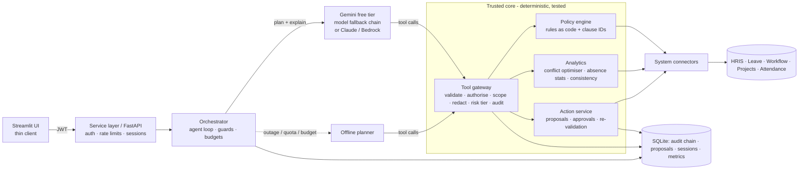

# HR Copilot: a governed, agentic HR operations assistant

**Author:** Hasaan Wahid · **Submission:** Buggcy AI Engineer technical assessment
**Live demo:** _<Streamlit URL - added after deployment>_ · **Stack:** Python 3.12, FastAPI, Streamlit, SQLite, Google Gemini (free tier; Claude and Bedrock supported)


HR Copilot is **not an FAQ chatbot**. An employee, manager or HR professional describes a messy, multi-part problem. An AI agent then:
1. **Investigates across five HR systems.**
2. Asks **deterministic engines** to make every policy and analytical call.
3. **Explains** the result with cited policy clauses.
4. **Prepares actions**, which a human confirms or approves according to risk.

Every answer is then **automatically checked** for invented facts.

> **Core idea: the AI plans and explains; code decides and enforces.**

---

## 1. The problem and the four scenarios

The brief's example requests can only be answered correctly by joining several systems and applying policy. That is where HR spends manual effort, and where a plain chatbot confidently hallucinates.

| Scenario (from the brief) | What it really needs | How HR Copilot solves it |
|---|---|---|
| **Employee:** two weeks off next month, project deadline, which approvals? | Balance + notice rules + approval chain + project deadlines + critical roles + team coverage | Policy engine checks 7 rules with clause IDs and finds the closest compliant dates |
| **Manager:** three people requested the same week before a critical delivery | Constraint optimisation: coverage ≥ 60%, critical-role protection, fair priority, alternatives | Exhaustive search over approve/decline plans, then alternative dates |
| **HR:** absences increasing; meaningful patterns? | Statistics, privacy (k-anonymity), data-quality handling | z-tests per department/team, Monday/Friday skew, link to project crunch, bad data excluded |
| **Employee:** changed department, approval still goes to the old manager | Cross-system reconciliation, root cause, a governed fix | HRIS vs workflow vs leave check, root cause, high-risk fix proposal for an HR admin |

## 2. Try it

**Live:** open the demo link above and pick a persona in the sidebar. Every visitor gets a **private sandbox** of synthetic data.

**Locally:**

```bash
python -m pip install -r requirements.txt
copy .env.example .env             # then put a free GEMINI_API_KEY in .env (optional)
python -m streamlit run frontend/streamlit_app.py          # UI: http://localhost:8501
python -m uvicorn app.main:app --port 8000                 # optional REST API: http://localhost:8000/docs
```

Without an API key everything still works: the deterministic **offline planner** answers through the same tools and governance.

**5-minute demo script**

1. **Ayesha (employee)**, scenario 1:
   - Notice period fails by one day, so it re-checks the closest compliant start date.
   - She is backend lead on a critical release whose deadline is in her leave, so she needs a department-head exception.
   - Shows team coverage and the approvers.
   - Then send *"Submit it, handover: …"*. This creates a proposal she confirms in **Actions**.
2. **Omar (manager)**, scenario 2:
   - Daily coverage, a recommended plan (approve Lucas and Fatima; offer Kenji, the tech lead, dates after the deadline) and the reasons.
   - Flags a **prompt-injection attempt** hidden in an employee's leave reason. Nothing is approved.
3. **Sana (HR business partner)**, scenario 3:
   - Finds a 3.75× absence spike in the Platform team during its release crunch, and a Monday/Friday skew in Support.
   - Lists the data-quality issues it excluded. Groups under 5 people are suppressed.
   - Ask for a salary: it's redacted, because HRBPs can't see compensation.
4. **Bilal (moved department)**, scenario 4: the root cause (workflow route synced before his move) and the stuck request. It raises a **high-risk fix** that Bilal **cannot approve himself**.
5. **Daniel (HR systems admin)**: Actions → **Approve**. The route is fixed and the pending request reassigned atomically. Then check **Audit** (hash chain valid) and **Value**.

## 3. Architecture



**One turn, end to end**
1. Login issues a signed JWT. The role and direct reports are resolved from **HRIS**, never from the client or the model.
2. Rate limit and token budgets are checked.
3. The LLM runs a function-calling loop with automatic execution **disabled**, so every call is executed by our gateway. With Gemini, a model that hits its free-tier quota is skipped and the next model in the chain is used.
4. **Every tool call passes the gateway:**
   - Pydantic validation (extra fields forbidden)
   - Permission check
   - Data scope (self / direct reports / organisation)
   - Field redaction (salary)
   - Risk tier
   - Audit entry
5. Writes become **proposals**. A human confirms (low risk) or a different, authorised human approves (high risk). Proposals are re-validated against live state and committed atomically.
6. **Guards** check the answer:
   - Numbers, dates and names must appear in this turn's tool results.
   - "Submitted / approved / fixed" is only allowed if an action executed.
   - Policy clause IDs must exist.

   On failure the model gets one automatic correction round; anything still unsupported is flagged to the user.
7. Metrics, the audit log and the session are persisted.

| Path | Responsibility |
|---|---|
| `frontend/streamlit_app.py`, `frontend/client.py` | Streamlit UI; client talks to the service in-process (live demo) or over HTTP (`API_URL`) |
| `app/main.py`, `app/service.py`, `app/auth.py` | REST API, service layer used by every frontend, JWT auth |
| `app/agent/` | Gemini and Claude planners (manual function-calling loops, circuit breaker, quota fallback), offline planner, guards, orchestrator, prompts |
| `app/tools.py`, `app/security.py`, `app/actions.py` | Tool catalogue + gateway, roles/scopes/redaction/untrusted-text spotlighting, approvals |
| `app/policy/`, `app/analytics.py` | Policy-as-code engine + clause KB; conflict optimiser, absence statistics, consistency checker |
| `app/systems.py`, `app/seed.py` | Connectors to 5 simulated systems; deterministic synthetic organisation with injected defects |
| `app/audit.py`, `app/metrics.py`, `app/limits.py`, `app/sessions.py` | Hash-chained audit, value/safety telemetry, rate limit + budgets, sessions |
| `evals/`, `scripts/`, `tests/` | Evaluation set + runner, scale test, Gemini setup check, 41 automated tests |

## 4. Key decisions (full log: [docs/DECISIONS.md](docs/DECISIONS.md))

1. **LLM plans; engines decide.** RAG plus the model "reasoning" about eligibility was rejected: untestable and prone to confident errors.
2. **Security lives in the gateway, never the prompt.** A seeded prompt injection proves it: the model may be fooled, but it has no tool that approves anything.
3. **Risk tiers + an autonomy dial** (`advisory`, `assisted`, `autonomous`) resolve the leadership disagreement. High-risk actions **never** auto-execute and need an approver who is not the requester.
4. **Gemini free tier for the public demo; a paid, no-training provider for real data.** The demo uses Google Gemini at zero cost, with a fallback chain across free models. Google may use free-tier prompts to improve its products, which is acceptable only because all demo data is synthetic. Real HR data needs a paid Gemini or Vertex AI project, or Claude via the Anthropic API or Bedrock; both are one environment variable away. OpenRouter was rejected: it adds a data processor, platform fees, and loses provider-specific features.
5. **Streamlit as a thin client.** It's fast to build and easy to host live. It holds no logic or authority, so a React frontend could replace it with no backend change.
6. **SQLite with a clean persistence boundary.** Zero setup; Postgres is a connection-string change.
7. **Hallucination guards + evals** turn "reliable" into numbers.
8. **Graceful degradation:** outage, open circuit breaker or budget cap all fall back to the offline planner.

## 5. Evidence

| What | Result | Details |
|---|---|---|
| Automated tests | **41 passed** (engines, governance invariants, JWT, persistence, guards, Gemini and Claude loops, quota fallback, headless UI) | `python -m pytest -q` |
| Offline eval set | **26/26 passed, 26/26 answers fully verified, 0 leaks, 0 unapproved actions** | [docs/EVALS.md](docs/EVALS.md) |
| Live eval set (Gemini) | _see docs/EVALS.md_ | `python evals/run_evals.py --mode live --pause 20` |
| Scale (50,057 employees, 130k absence records) | per-person tools ≤ 2 ms; org-wide absence analytics ~0.8 s | [docs/SCALE.md](docs/SCALE.md) |
| Security scans | ruff (incl. bandit rules), bandit, pip-audit: **clean** | CI pipeline |

## 6. Business value

The **Value** tab tracks:
- Requests by category, and outcomes.
- AI spend and cost per request; latency.
- Unauthorised requests blocked, and guard catches.
- **Estimated manual effort avoided**, based on explicit, editable assumptions in `app/config.py`.

A pilot plan to replace the assumptions with real numbers is in [docs/DECISIONS.md](docs/DECISIONS.md#adr-14-business-case-and-pilot). Running cost is mostly LLM tokens, visible per request and capped by daily and per-session budgets.

## 7. Assumptions

- All data is synthetic and generated relative to the seed date, so the scenarios always line up.
- Policy is a fictional handbook ([app/policy/handbook.md](app/policy/handbook.md)) with one global calendar.
- Login is a demo JWT issuer standing in for company SSO. Production would verify OIDC tokens; nothing downstream changes.

## 8. Limitations

- **Simulated integrations and demo login.** Real HRIS/workflow connectors and SSO are roadmap items.
- **SQLite, single process.** Rate limits and budgets are in-memory per process. On Streamlit Cloud each visitor's sandbox is in memory and resets when the session ends.
- **Simplified policy:** one country, no part-time pro-rating or half days. Leave spanning two years is charged to the start year.
- **Analytics:** current team membership is used for history. The z-tests assume independent absences. Fine for triage, not formal reporting.
- **Guards are heuristic:** they catch invented figures, dates and names, but not a wrong conclusion drawn from correct numbers. Evals cover that.
- **Offline planner** is keyword-based and covers the demo intents. Open-ended conversation needs Claude.

## 9. Path to production

The full list, with security and privacy detail, is in [docs/SECURITY.md](docs/SECURITY.md), [docs/PRIVACY.md](docs/PRIVACY.md) and [docs/RUNBOOK.md](docs/RUNBOOK.md):
1. OIDC SSO.
2. Real connectors with idempotency keys.
3. Postgres with row-level security, and Redis for limits.
4. A paid, no-training model endpoint (Vertex AI Gemini, or Claude via Bedrock) with a DPA, zero data retention and an EU region.
5. Event-driven proactive checks, e.g. a reporting-line change triggering a routing check.
6. Teams/Slack approvals.
7. Eval gates in CI on every prompt or model change.
8. A penetration test and DPIA. EU AI Act high-risk obligations for employment AI apply from **2 December 2027**.

## 10. Deploy

See [docs/DEPLOYMENT.md](docs/DEPLOYMENT.md): push to GitHub, then deploy on Streamlit Community Cloud (sign in with GitHub) with the free Gemini key in Secrets.
